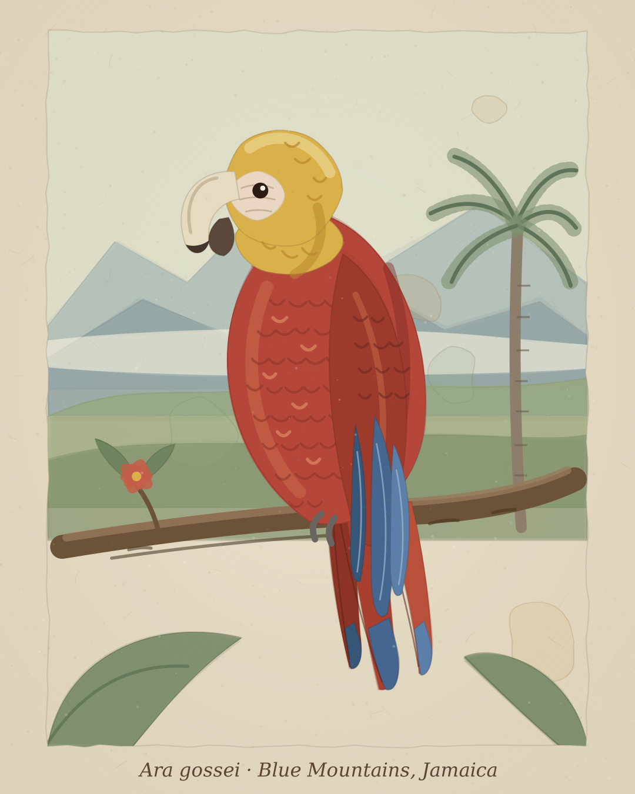

# Extinct Animals Art

Generador local de láminas 4:5 con aspecto de acuarela antigua para especies extintas o desaparecidas. El proyecto combina SVG procedural, paletas de color, paisajes y un dibujo específico para cada especie. No necesita API ni servicios de pago y, usando la misma semilla, vuelve a producir la misma ilustración.



La imagen anterior es el resultado de:

```bash
python generate.py ara_gossei --palette acuarela_antigua --seed 7
```

## Qué se puede hacer ahora

- Elegir una especie registrada por su identificador (`ara_gossei`).
- Guardar el nombre científico y el nombre común en la ficha de la especie.
- Añadir una descripción histórica o artística a esa ficha. La descripción queda incluida en el `<desc>` del SVG, además de servir como documentación.
- Elegir paleta, paisaje, semilla y tamaño de salida.
- Generar SVG, PNG o ambos.
- Quitar el rótulo, el granulado del papel o la flor de la composición.
- Trabajar con bocetos y referencias guardándolos en `references/<identificador>/`. Sirven para estudiar anatomía, postura, color y fuentes; el dibujo final se implementa en el módulo Python de la especie.
- Consultar las 58 fichas individuales de `references/species/`, preparadas a partir de la lista de `docs/especies-notas.md` y con enlaces para completar la investigación.
- Crear una especie nueva automáticamente con `new_species.py`, sin copiar archivos a mano.
- Validar que el catálogo, los paisajes y las fichas de referencia están conectados correctamente.

El programa no convierte todavía automáticamente un texto o un boceto en una especie dibujada. La geometría debe escribirse a mano porque cada animal tiene una anatomía diferente. Sí queda preparado un flujo claro para introducir el nombre, la investigación, las fuentes, los bocetos y después traducirlos a formas SVG.

## Instalación

```bash
python -m venv .venv
# Windows PowerShell
.\.venv\Scripts\Activate.ps1
# macOS/Linux
source .venv/bin/activate
pip install -r requirements.txt
```

`cairosvg` se usa para exportar a PNG. El SVG puede generarse sin esa dependencia. Si Cairo no funciona en Windows, instala Inkscape o `rsvg-convert`, o usa `--no-png`.

## Crear una ilustración de una especie, paso a paso

Este es el flujo recomendado para pasar de una idea o una especie de tus notas a una lámina terminada.

### Paso 1: elegir y nombrar la especie

Escoge una especie de `docs/especies-notas.md` o añade una nueva. Define un identificador simple, en minúsculas y con guiones bajos: `dodo`, `pinguinus_impennis` o `capra_pyrenaica_lusitanica`. Ese identificador se utilizará en los nombres de archivos y en el comando de generación.

Para crear automáticamente los dos archivos iniciales:

```bash
python new_species.py dodo "Raphus cucullatus" "Dodo" --kind bird --landscape generic
```

El comando crea el módulo Python y la ficha Markdown, y nunca sobrescribe una especie existente.

### Paso 2: crear la carpeta de trabajo

Dentro de `references/species/`, utiliza la ficha Markdown del identificador:

```text
references/
└── species/
    ├── pinguinus_impennis.md
    └── pinguinus_impennis_bocetos/
        ├── boceto_postura.jpg
        └── referencia_historica.png
```

### Paso 3: completar la investigación

Copia [`docs/plantilla-especie.md`](docs/plantilla-especie.md) y guárdala como `references/species/<identificador>.md`. Incluye nombre científico y nombres históricos o comunes, fecha y lugar aproximados de desaparición, descripción anatómica, hábitat, grado de certeza, fuentes, decisiones visuales y advertencias para no presentar una hipótesis como un hecho.

Los bocetos pueden guardarse en `references/species/<identificador>_bocetos/`. Anota para cada imagen su autoría, licencia y enlace de origen. Un boceto puede orientar la postura, el tamaño, la silueta o los colores, pero no se incorpora automáticamente al SVG.

### Paso 4: crear el módulo de dibujo

Copia uno de los módulos de `extinct_art/species/` como `extinct_art/species/<identificador>.py`, o parte de una ficha ya preparada. Cada módulo contiene `META`, `COLORS` y `draw(rng_for)`. `META` debe contener:

```python
META = {
    "scientific_name": "Pinguinus impennis",
    "common_name": "Alca gigante",
    "slug": "pinguinus_impennis",
    "kind": "bird",           # bird, mammal o reptile
    "landscape": "generic",   # sustituir por un paisaje disponible
    "status": "extinta",
    "description": "Ave marina no voladora del Atlántico norte.",
}
```

La función `draw` devuelve fragmentos SVG. Las fichas nuevas reutilizan `draw_taxon` de `extinct_art/species/base.py`, que ofrece una silueta inicial de ave, mamífero o reptil. Para una ilustración fiel hay que sustituir esa silueta por geometría específica usando `wash`, `stroke`, `blob` y `scale_marks` desde `extinct_art/brush.py`. El papel, el grano, el paisaje y la rama los añade `compose.py` automáticamente.

### Paso 5: registrar la especie

No hace falta editar manualmente `extinct_art/species/__init__.py`. El proyecto descubre automáticamente todos los módulos `.py` de esa carpeta que tengan `META` y `draw`. Comprueba el registro con:

```python
python generate.py --validate
python generate.py --list
python generate.py pinguinus_impennis --describe
```

### Paso 6: generar una primera versión

```bash
python generate.py --list
python generate.py pinguinus_impennis --seed 7
python generate.py pinguinus_impennis --palette sepia --no-png
python generate.py pinguinus_impennis --all-palettes --width 2160
python generate.py --all-species --no-png
```

`--validate` comprueba los campos obligatorios, el grupo animal, las URLs y la existencia de cada ficha Markdown. `--describe` muestra los metadatos que utilizará el generador.

Los archivos aparecen en `output/`. Esa carpeta se puede borrar y regenerar; las fuentes, fichas y bocetos deben conservarse en `references/`.

### Paso 7: revisar la ilustración

Abre el SVG o PNG y comprueba la silueta, la postura, los colores, el paisaje, el rótulo y el grado de fidelidad de cada rasgo. Si algo no está respaldado por una fuente, indícalo como interpretación en la ficha. Ajusta `COLORS`, las formas SVG y `META["description"]`, y vuelve a generar con la misma semilla para comparar cambios.

### Paso 8: conservar una versión reproducible

Apunta en la ficha el comando utilizado, por ejemplo:

```text
python generate.py pinguinus_impennis --palette sepia --seed 7 --width 2160
```

Conserva la ficha, las fuentes y los bocetos. El contenido de `output/` no es necesario para reconstruir la imagen, porque el proyecto lo genera de nuevo.

## Mejoras posibles del proyecto

### Mejoras ya aplicadas

- Se han creado módulos Python para los 58 taxones de las anotaciones.
- El registro de especies es automático: añadir un `.py` con `META` y `draw` basta.
- Se puede validar el catálogo con `python generate.py --validate`.
- Se pueden generar todas las especies con `python generate.py --all-species`.
- Las siluetas iniciales se reutilizan por grupo animal mediante `species/base.py`.
- Las fichas y los módulos guardan el enlace de referencia usado para investigar cada taxón.
- Se ha añadido un paisaje `generic` para evitar asignar Jamaica a especies que no corresponden a ese lugar.
- `new_species.py` crea una ficha y un módulo nuevos sin sobrescribir archivos existentes.
- La validación comprueba también las URLs y la existencia de las fichas Markdown.
- `--describe` permite revisar los metadatos antes de generar una lámina.
- Los tests comprueban la integridad del catálogo completo.

Las fichas nuevas son una base visual inicial: los módulos funcionan y generan SVG, pero una reconstrucción anatómica rigurosa requiere sustituir la silueta genérica de cada especie por geometría específica después de revisar sus restos, ejemplares, láminas y descripciones.

Estas son las mejoras que considero más útiles, ordenadas aproximadamente por prioridad:

1. **Separar los datos del dibujo.** Mover `META` y las referencias a JSON o YAML para que una futura interfaz edite fichas sin tocar Python.
2. **Generar una composición de estudio.** Incluir nombre, descripción, estado, fecha y fuentes en una lámina documental.
3. **Añadir un modo de boceto.** Mostrar una imagen de referencia junto al resultado, conservando autoría y licencia.
4. **Incorporar más perfiles reutilizables.** Añadir peces, anfibios, plantas, aves marinas, mamíferos con cuernos y animales no voladores.
5. **Crear una galería de previsualización.** Generar una cuadrícula HTML o contacto PNG con todas las especies y paletas.
6. **Mejorar la salida editorial.** Añadir formatos de impresión, márgenes, tipografías y exportación para redes sociales.
7. **Refinar la anatomía especie por especie.** Sustituir las siluetas genéricas por geometría basada en ejemplares, restos y láminas históricas.
8. **Revisar taxonomía y licencias.** Mantener fuentes, sinonimias, fechas y permisos en cada ficha de referencia.

La mejora más valiosa para el uso diario sería la primera: permitiría cambiar nombres, descripciones, fuentes y notas sin tocar el código que dibuja la anatomía. La generación automática a partir de un boceto podría añadirse más adelante, pero debería mantener una revisión humana porque muchas especies extintas solo se conocen de forma incompleta.

## Opciones de generación

```text
new_species.py SLUG "Nombre científico" "Nombre común" --kind bird|mammal|reptile
--describe              muestra los metadatos de la especie elegida
--validate              valida especies y fichas
--all-species            genera una imagen por cada especie
--palette NOMBRE       acuarela_antigua, sepia o amanecer
--all-palettes          genera una versión por paleta
--landscape NOMBRE      fuerza el paisaje de fondo
--seed NÚMERO           controla la variación de la pincelada
--width PÍXELES         ancho del PNG; la altura mantiene la proporción 4:5
--out CARPETA           carpeta de salida
--no-png                solo SVG
--no-caption            elimina el rótulo inferior
--no-grain              elimina el granulado del papel
--no-flower             elimina el hibisco de la rama
--list                  muestra especies, paletas y paisajes disponibles
```

## Estructura

| Ruta | Contenido |
| --- | --- |
| `generate.py` | Interfaz de línea de comandos y generación por lotes |
| `new_species.py` | Crea el módulo y la ficha de una especie nueva |
| `extinct_art/compose.py` | Composición de papel, paisaje, rama y especie |
| `extinct_art/species/` | Una ficha visual Python por especie |
| `extinct_art/species/base.py` | Siluetas y primitivas reutilizables por grupo animal |
| `extinct_art/species/__init__.py` | Descubrimiento y validación automática de módulos |
| `extinct_art/brush.py` | Manchas, pinceladas, bordes y textura |
| `extinct_art/palettes.py` | Paletas de la lámina |
| `extinct_art/landscapes.py` | Paisajes disponibles |
| `references/species/` | Una ficha Markdown por cada taxón de las anotaciones |
| `references/` | Fuentes, bocetos y material de trabajo |
| `docs/plantilla-especie.md` | Plantilla para investigar una especie |
| `docs/especies-notas.md` | Anotaciones recibidas para futuras ilustraciones |
| `output/` | SVG y PNG generados |

## Criterios de documentación y rigor

Estas láminas son interpretaciones artísticas, no reconstrucciones exactas. Cuando una especie solo se conoce por relatos, restos o una lámina posterior, esa incertidumbre debe aparecer en `META`, en la ficha y, si procede, en la publicación final. Conviene distinguir entre nombre científico moderno, nombres usados históricamente y nombres populares.

La lista de animales de `docs/especies-notas.md` es un punto de partida, no una verificación taxonómica definitiva. Antes de dibujar o publicar una especie, comprueba su estado, sinonimias, fecha de extinción y fuentes primarias o institucionales.

## Tests

```bash
python -m unittest discover
```

Los tests comprueban que todas las especies y paletas producen XML válido y que la semilla mantiene la reproducibilidad.
